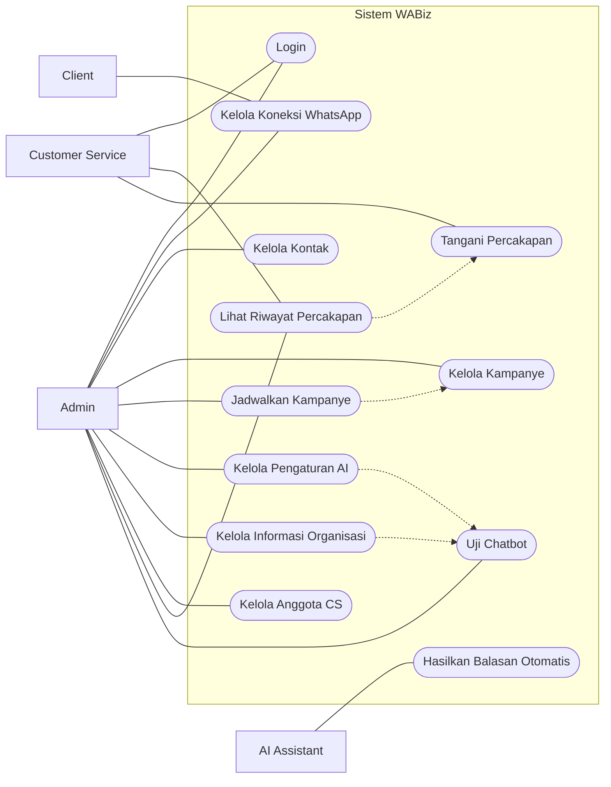
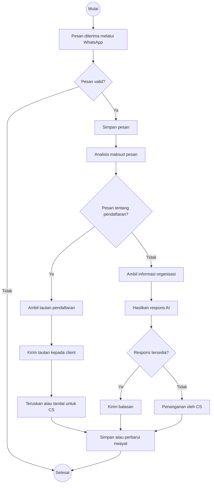
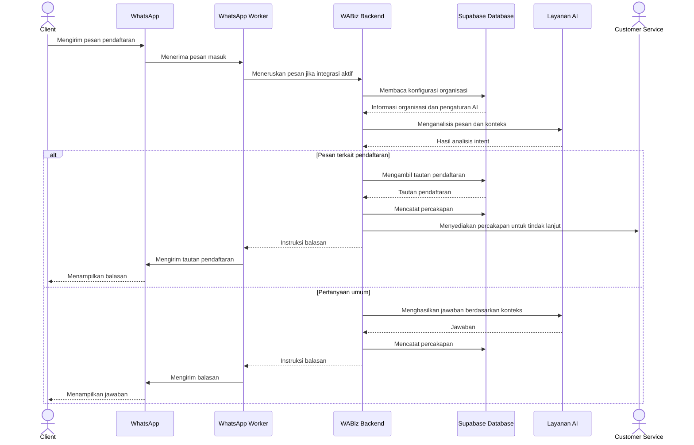
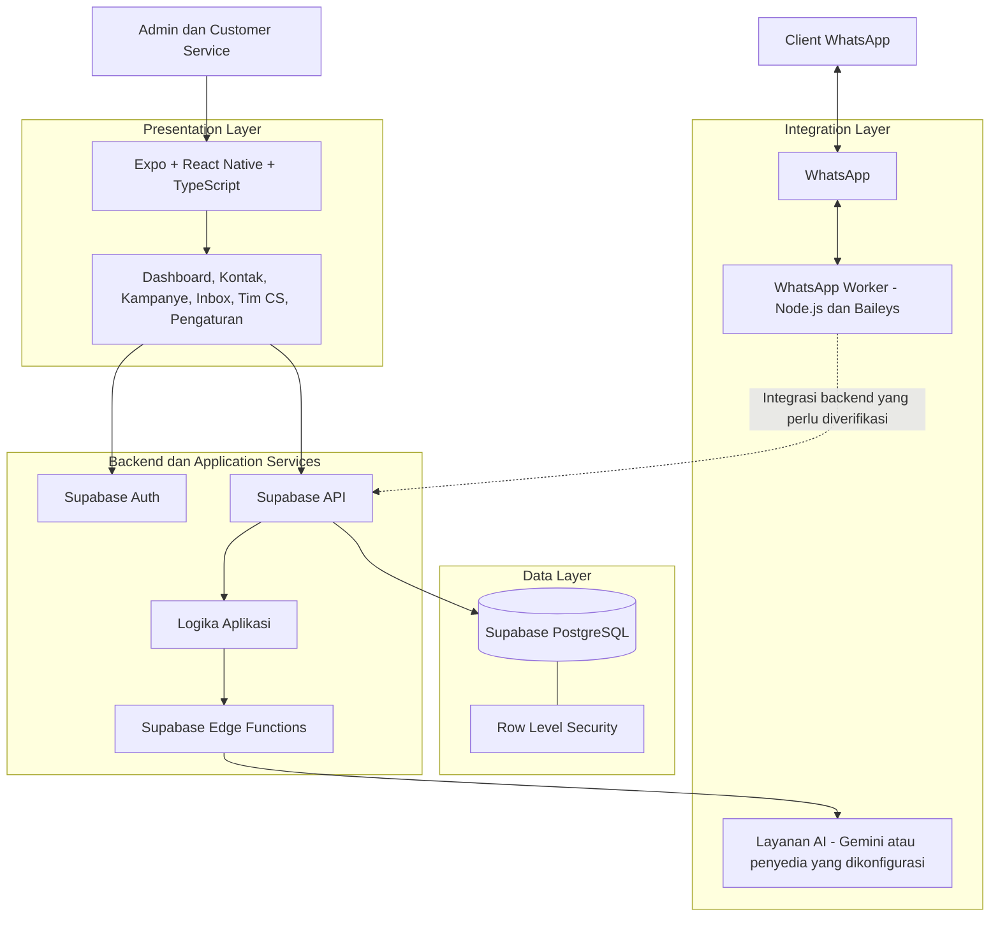

# WABiz — WhatsApp Business Management System

## Deskripsi Proyek (20 Poin)

WABiz merupakan aplikasi manajemen komunikasi berbasis WhatsApp yang dirancang untuk membantu organisasi dan bisnis mengelola komunikasi dengan pelanggan secara terpusat. Sistem ini ditujukan untuk berbagai jenis organisasi, seperti pondok pesantren, lembaga pendidikan, dan organisasi lainnya.

Proyek ini dikembangkan untuk memenuhi tugas mata kuliah **Analisis & Pengujian Sistem**, dengan fokus pada analisis kebutuhan, perancangan sistem menggunakan Unified Modeling Language (UML), implementasi aplikasi, integrasi layanan backend, dan pengujian fungsional.

WABiz dirancang untuk mengintegrasikan pengelolaan kontak, percakapan, kampanye pesan, anggota Customer Service (CS), informasi organisasi, dan asisten AI dalam satu aplikasi.

### Tujuan Proyek

1. Menganalisis kebutuhan sistem komunikasi WhatsApp untuk organisasi dan bisnis.
2. Merancang proses bisnis dan interaksi pengguna menggunakan diagram UML.
3. Mengimplementasikan antarmuka aplikasi yang mudah digunakan dan responsif.
4. Mengelola data organisasi, kontak, percakapan, kampanye, dan anggota CS secara terstruktur.
5. Mengembangkan asisten AI yang dapat membantu menjawab pertanyaan berdasarkan informasi resmi organisasi.
6. Menyiapkan integrasi WhatsApp untuk mendukung penerimaan pesan dan balasan otomatis.
7. Melakukan pengujian fungsional untuk memeriksa kesesuaian fitur dengan kebutuhan sistem.

### Fitur Utama

- **Dashboard:** Menampilkan ringkasan aktivitas dan data aplikasi.
- **Manajemen Kontak:** Mengelola data kontak, nomor WhatsApp, label, dan catatan.
- **Manajemen Percakapan:** Mengelola riwayat komunikasi dan pesan pelanggan.
- **Manajemen Kampanye:** Mengelola kampanye pesan serta rancangan pengiriman terjadwal.
- **Chatbot AI:** Mengatur konfigurasi asisten AI dan menguji respons berdasarkan informasi organisasi.
- **Tim Customer Service:** Mengelola anggota CS dan pembagian tanggung jawab.
- **Pengaturan Organisasi:** Mengelola identitas, deskripsi, kontak, dan informasi lokasi organisasi.
- **Integrasi Backend:** Menggunakan Supabase untuk mendukung autentikasi dan penyimpanan data.
- **Integrasi WhatsApp:** Menyiapkan worker WhatsApp berbasis Baileys untuk proses pairing melalui QR dan penanganan pesan.

> **Catatan status implementasi:** Tidak semua fitur yang dirancang telah terintegrasi penuh. Fitur yang masih menggunakan simulasi, belum terhubung ke layanan produksi, atau belum lulus pengujian harus dibedakan dari fitur yang sudah berjalan. Integrasi WhatsApp berbasis Baileys juga merupakan jalur pengembangan terpisah dari integrasi resmi WhatsApp Business Platform.

---

## Desain Proyek — Unified Modeling Language (20 Poin)

Perancangan sistem WABiz menggunakan Unified Modeling Language (UML) untuk memvisualisasikan kebutuhan fungsional, alur aktivitas, dan urutan interaksi antaraktor maupun komponen sistem.

Diagram yang digunakan meliputi:

1. Use Case Diagram
2. Activity Diagram
3. Sequence Diagram

### 1. Use Case Diagram

Use Case Diagram menggambarkan hubungan antara aktor dan fungsi yang tersedia pada sistem WABiz.

**Aktor yang terlibat:**

- **Admin:** Mengelola organisasi, kontak, kampanye, chatbot AI, anggota CS, dan pengaturan sistem.
- **Customer Service (CS):** Melihat serta menangani percakapan yang menjadi tanggung jawabnya.
- **Client:** Mengirim pesan dan menerima balasan melalui WhatsApp.
- **Layanan AI:** Menganalisis pesan dan membantu menghasilkan respons otomatis apabila integrasi AI diaktifkan.

**Diagram Use Case WABiz**




**Penjelasan:**

Admin memiliki hak untuk mengelola konfigurasi utama aplikasi. Customer Service berfokus pada penanganan percakapan, sedangkan client berkomunikasi melalui WhatsApp. Layanan AI berperan sebagai komponen pendukung yang menganalisis pesan dan menghasilkan balasan berdasarkan konfigurasi serta informasi organisasi yang tersedia.

Diagram ini menggambarkan cakupan fungsional sistem. Hak akses aktual tetap ditentukan oleh implementasi autentikasi dan kebijakan otorisasi aplikasi.

### 2. Activity Diagram

Activity Diagram menggambarkan alur aktivitas ketika sistem menerima pesan pelanggan dan menentukan cara penanganannya.

**Diagram Activity WABiz — Penanganan Pesan**




**Penjelasan alur aktivitas:**

1. Sistem menerima pesan dari client melalui koneksi WhatsApp.
2. Pesan diperiksa untuk memastikan pesan layak diproses.
3. Pesan disimpan atau dicatat dalam riwayat percakapan.
4. Sistem menganalisis maksud pesan untuk menentukan jenis pertanyaan.
5. Jika pesan berkaitan dengan pendaftaran, sistem dapat memberikan tautan pendaftaran yang telah dikonfigurasi.
6. Jika pesan merupakan pertanyaan umum, sistem dapat mengambil informasi organisasi sebagai sumber jawaban AI.
7. Jika respons berhasil dihasilkan, sistem mengirimkan balasan kepada client.
8. Jika respons tidak tersedia atau memerlukan bantuan manusia, percakapan dapat ditangani oleh CS.
9. Riwayat percakapan diperbarui untuk mendukung pemantauan dan tindak lanjut.

Alur tersebut merupakan rancangan proses yang dituju. Implementasi setiap langkah perlu diverifikasi melalui pengujian aplikasi.

### 3. Sequence Diagram

Sequence Diagram menggambarkan urutan pertukaran pesan antara client, WhatsApp, worker WhatsApp, backend WABiz, layanan AI, database, dan Customer Service.

**Sequence Diagram WABiz — Penanganan Pesan Pendaftaran**




**Penjelasan sequence:**

1. Client mengirimkan pesan melalui WhatsApp.
2. Worker WhatsApp menerima pesan masuk.
3. Dalam arsitektur target, pesan diteruskan ke backend WABiz untuk diproses.
4. Backend mengambil informasi organisasi dan konfigurasi AI dari database.
5. Layanan AI menganalisis maksud pesan.
6. Sistem menentukan respons berdasarkan hasil analisis.
7. Untuk pesan pendaftaran, sistem menggunakan tautan yang telah dikonfigurasi dan dapat menyediakan percakapan kepada CS.
8. Untuk pertanyaan umum, sistem menghasilkan respons berdasarkan konteks informasi organisasi.
9. Pesan dan hasil penanganan dicatat sesuai implementasi penyimpanan yang tersedia.
10. Balasan dikirim kembali kepada client melalui worker dan WhatsApp.

**Batasan diagram:** Diagram ini menjelaskan arsitektur target yang direncanakan. Jalur worker Baileys yang saat ini dikembangkan tidak boleh diasumsikan sudah melewati seluruh komponen backend dan layanan AI pada diagram sampai integrasinya benar-benar diterapkan dan diuji.

---

## Arsitektur Proyek (20 Poin)

WABiz menggunakan arsitektur aplikasi client-server dengan layanan backend terkelola dan komponen worker untuk integrasi WhatsApp.

Secara umum, sistem terdiri atas empat lapisan utama:

1. **Presentation Layer:** Antarmuka aplikasi yang digunakan admin dan Customer Service.
2. **Application Layer:** Logika aplikasi untuk mengelola data, memproses permintaan, dan mengatur alur bisnis.
3. **Data Layer:** Penyimpanan data organisasi, pengguna, kontak, kampanye, dan percakapan.
4. **Integration Layer:** Komponen yang menghubungkan sistem dengan layanan AI dan WhatsApp.

### Diagram Arsitektur WABiz



### Penjelasan Komponen

**1. Frontend**

Frontend dikembangkan menggunakan React Native dan Expo dengan bahasa TypeScript. Antarmuka menyediakan halaman dashboard, percakapan, kontak, kampanye, chatbot AI, tim CS, dan pengaturan organisasi.

**2. Backend dan Autentikasi**

Supabase digunakan untuk mendukung autentikasi pengguna dan akses data melalui layanan backend. Supabase Edge Functions dapat digunakan untuk menjalankan logika server, termasuk integrasi AI yang memerlukan pemrosesan di sisi server.

**3. Database**

Supabase PostgreSQL digunakan sebagai basis data relasional. Row Level Security (RLS) digunakan untuk membatasi akses data berdasarkan kebijakan yang telah dikonfigurasi. Kebijakan tersebut perlu diuji untuk memastikan pengguna hanya dapat mengakses data yang diizinkan.

**4. WhatsApp Worker**

Worker terpisah dikembangkan menggunakan Node.js dan Baileys untuk mengelola sesi WhatsApp, pairing melalui QR, serta penanganan pesan masuk dan keluar.

Worker ini merupakan komponen integrasi tersendiri. Konektivitas worker dengan backend, ketahanan sesi, dan perilaku pengiriman pesan harus diuji sebelum digunakan secara operasional.

**5. Layanan AI**

Layanan AI dirancang untuk menganalisis pesan dan menghasilkan jawaban berdasarkan konteks serta informasi organisasi. Kunci API dan kredensial rahasia harus disimpan di lingkungan server, bukan ditanamkan di kode frontend.

### Aspek Keamanan

- Autentikasi pengguna melalui Supabase Auth.
- Pembatasan akses data menggunakan RLS.
- Validasi input pada operasi yang mengubah data.
- Penyimpanan rahasia menggunakan environment variables atau secret management pada sisi server.
- Pembatasan akses terhadap endpoint worker WhatsApp.
- Perlindungan kredensial dan sesi WhatsApp.
- Pengujian akses lintas organisasi untuk memastikan isolasi data.

---

## Tech Stack (20 Poin)

Tech stack berikut disesuaikan dengan teknologi yang digunakan atau direncanakan dalam repositori WABiz.

| Komponen | Teknologi | Fungsi |
|---|---|---|
| Frontend | React Native | Membangun antarmuka aplikasi |
| Framework Frontend | Expo | Menjalankan dan mengembangkan aplikasi React Native |
| Bahasa Frontend | TypeScript | Menambahkan pemeriksaan tipe pada kode |
| Backend as a Service | Supabase | Menyediakan layanan backend terkelola |
| Authentication | Supabase Auth | Mengelola autentikasi pengguna |
| Database | PostgreSQL melalui Supabase | Menyimpan data terstruktur |
| Data Access Control | Supabase RLS | Membatasi akses data berdasarkan kebijakan |
| Serverless Functions | Supabase Edge Functions | Menjalankan logika backend dan integrasi layanan |
| WhatsApp Worker | Node.js dan Baileys | Mengelola koneksi WhatsApp melalui worker terpisah |
| AI Service | Gemini atau layanan AI yang dikonfigurasi | Membantu analisis pesan dan penyusunan respons |
| Version Control | Git | Melacak perubahan kode |
| Repository Hosting | GitHub | Menyimpan kode dan dokumentasi proyek |
| Testing | Pengujian fungsional dan integrasi | Memverifikasi perilaku sistem |

**Catatan:** Go, Flutter, dan MongoDB bukan stack utama yang teridentifikasi pada implementasi WABiz saat ini. Karena itu, README menggunakan React Native, Expo, TypeScript, dan Supabase agar sesuai dengan proyek yang telah dibangun. Versi paket, layanan AI yang aktif, dan dependensi worker perlu diverifikasi langsung pada file konfigurasi repositori.

---

## Pengujian Sistem

Pengujian dilakukan untuk memeriksa apakah setiap fitur bekerja sesuai kebutuhan dan untuk menemukan kesalahan sebelum demonstrasi UTS.

### Rencana Pengujian Fungsional

| ID | Fitur yang Diuji | Skenario Pengujian | Hasil yang Diharapkan |
|---|---|---|---|
| TC-01 | Login | Pengguna memasukkan kredensial valid | Pengguna dapat masuk ke aplikasi |
| TC-02 | Login | Pengguna memasukkan kredensial tidak valid | Sistem menolak login |
| TC-03 | Manajemen kontak | Menambahkan kontak dengan data valid | Kontak tersimpan dan muncul pada daftar |
| TC-04 | Pencarian kontak | Mencari kontak berdasarkan nama atau nomor | Sistem menampilkan hasil yang sesuai |
| TC-05 | Kampanye | Membuat kampanye baru | Data kampanye tersimpan sesuai implementasi |
| TC-06 | Tim CS | Menambahkan anggota CS | Anggota muncul pada daftar tim |
| TC-07 | Pengaturan organisasi | Memperbarui profil organisasi | Perubahan tersimpan dan dapat ditampilkan kembali |
| TC-08 | Chatbot AI | Menguji pertanyaan yang sesuai dengan informasi organisasi | Respons sesuai dengan konteks yang tersedia |
| TC-09 | WhatsApp Worker | Menghubungkan sesi melalui QR | Sesi berhasil terhubung jika pairing berhasil |
| TC-10 | WhatsApp Worker | Mengirim pesan masuk dari nomor penguji | Worker menerima pesan yang memenuhi kriteria pemrosesan |
| TC-11 | Balasan otomatis | Mengirim pertanyaan berbeda | Sistem menghasilkan respons yang sesuai, bukan mengulang jawaban yang tidak relevan |
| TC-12 | Keamanan data | Mengakses data yang tidak diizinkan | Sistem menolak akses sesuai kebijakan |

### Kriteria Pengujian

Pengujian dinyatakan berhasil jika hasil aktual sesuai dengan hasil yang diharapkan. Setiap pengujian perlu dicatat dengan:

- ID pengujian.
- Langkah pengujian.
- Data masukan.
- Hasil yang diharapkan.
- Hasil aktual.
- Status: Berhasil, Gagal, atau Belum Diuji.
- Bukti berupa screenshot atau log yang relevan.

Tabel di atas merupakan **rencana pengujian**, bukan klaim bahwa seluruh pengujian sudah berhasil. Statusnya perlu diperbarui berdasarkan hasil eksekusi pada aplikasi.

---

## Instalasi dan Menjalankan Proyek

### Prasyarat

- Node.js dan npm.
- Git.
- Expo CLI melalui `npx expo`.
- Proyek Supabase dan konfigurasi environment yang diperlukan.
- Perangkat atau emulator untuk menjalankan aplikasi.

### 1. Clone Repository

```bash
git clone <URL_REPOSITORY_GITHUB>
cd wa-biz
npm install
```

### 2. Konfigurasi Environment

Buat file `.env` berdasarkan `.env.example`, kemudian isi konfigurasi yang diperlukan, misalnya URL proyek Supabase dan publishable key.

Jangan memasukkan service role key, kunci privat, atau kredensial rahasia ke dalam frontend maupun repositori publik.

### 3. Jalankan Aplikasi Frontend

```bash
npx expo start
```

Untuk menjalankan aplikasi pada browser, jika dependensi web sudah terpasang:

```bash
npx expo start --web
```

### 4. Jalankan WhatsApp Worker

Worker merupakan proyek terpisah. Masuk ke direktori worker yang sesuai dengan struktur repositori, lalu jalankan perintah yang tersedia pada `package.json` milik worker.

Contoh, jika script `start` telah dikonfigurasi:

```bash
npm start
```

Perintah tersebut harus dijalankan dari direktori worker, bukan diasumsikan berjalan dari root frontend. Konfigurasi port, endpoint health check, dan environment worker mengikuti implementasi aktual.

---

## Repository GitHub dan Demonstrasi UTS (20 Poin)

**Repository GitHub:** [Tambahkan URL repositori WABiz di sini]

Repository ini memuat kode sumber, dokumentasi, diagram UML, konfigurasi yang tidak bersifat rahasia, dan artefak pengujian sistem.

### Rencana Demonstrasi

1. Menjelaskan tujuan dan kebutuhan utama sistem WABiz.
2. Menunjukkan diagram Use Case, Activity, dan Sequence.
3. Menjelaskan arsitektur aplikasi serta fungsi setiap komponen.
4. Menunjukkan halaman dashboard dan pengelolaan kontak.
5. Mendemonstrasikan pengelolaan kampanye dan anggota CS.
6. Menunjukkan pengaturan informasi organisasi dan chatbot AI.
7. Mendemonstrasikan autentikasi serta penyimpanan data apabila sudah terhubung.
8. Mendemonstrasikan koneksi WhatsApp dan balasan otomatis apabila worker berhasil dijalankan.
9. Menunjukkan bukti pengujian fungsional dan menjelaskan keterbatasan yang masih ada.

### Artefak Proyek

```text
wa-biz/
├── App.tsx
├── package.json
├── .env.example
├── docs/
│   └── images/
│       ├── use-case.png
│       ├── activity.png
│       └── sequence.png
├── src/
│   └── ...
└── server/
    └── ...
```

Struktur di atas merupakan gambaran umum. Nama dan lokasi file harus disesuaikan dengan struktur repositori aktual. Pastikan file gambar diagram tersedia apabila README menggunakan tautan gambar.

---

## Kesimpulan

WABiz merupakan proyek pengembangan sistem komunikasi WhatsApp untuk mendukung pengelolaan pelanggan, percakapan, kampanye, Customer Service, informasi organisasi, dan asisten AI.

Melalui analisis kebutuhan, perancangan UML, implementasi frontend dan backend, serta pengujian fungsional, proyek ini menerapkan tahapan pengembangan sistem informasi yang relevan dengan mata kuliah Analisis & Pengujian Sistem.

Dokumentasi ini membedakan rancangan sistem, fitur yang sudah diimplementasikan, dan integrasi yang masih memerlukan verifikasi. Dengan demikian, repositori dapat digunakan sebagai dokumentasi teknis sekaligus bahan demonstrasi dan evaluasi pada UTS.
