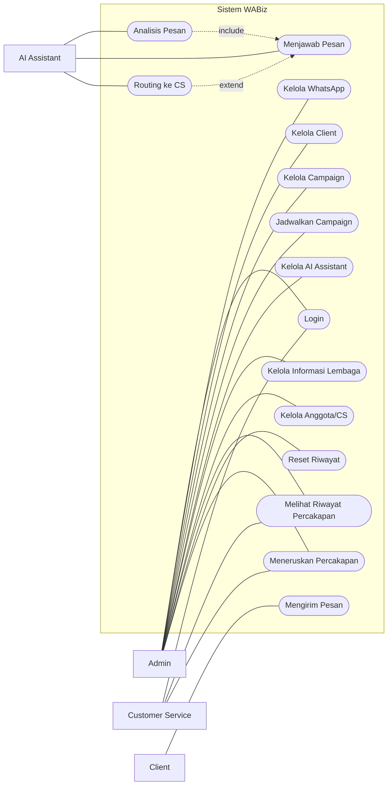
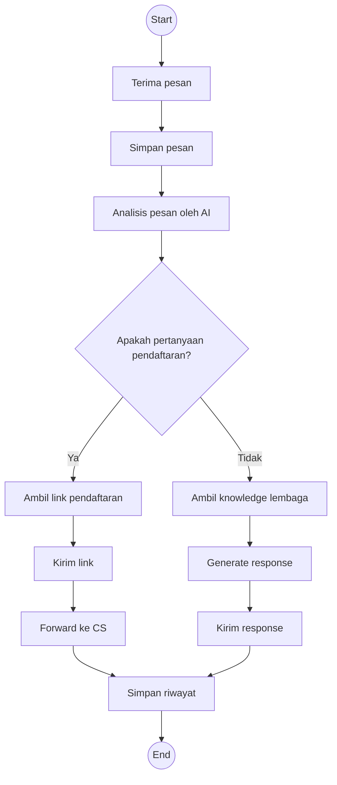
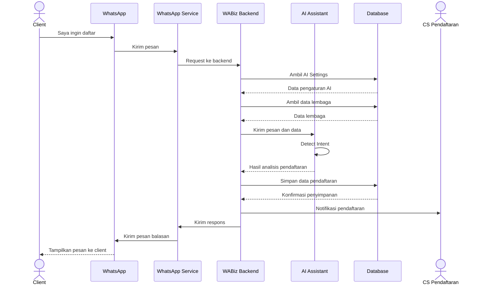

# Desain Proyek (UML)

Perancangan sistem WABiz menggunakan Unified Modeling Language (UML) untuk menggambarkan kebutuhan, aktivitas, dan interaksi antara aktor dengan sistem.

Diagram UML yang digunakan dalam perancangan WABiz meliputi:

- Use Case Diagram
- Activity Diagram
- Sequence Diagram

---

## 1. Use Case Diagram

Use Case Diagram menggambarkan interaksi antara aktor dengan fungsi-fungsi yang tersedia pada sistem WABiz.

### Use Case Diagram WABiz

**Aktor yang terlibat:**

- **Admin** — mengelola sistem, WhatsApp, client, campaign, AI Assistant, informasi lembaga, CS, dan percakapan.
- **Customer Service (CS)** — melihat dan menangani percakapan yang menjadi tanggung jawabnya.
- **Client** — mengirim pesan dan berinteraksi dengan sistem melalui WhatsApp.
- **AI** — menganalisis pesan, memberikan respons otomatis, dan membantu melakukan routing percakapan.

### Alur Use Case Diagram

---

## 2. Activity Diagram

Activity Diagram menggambarkan alur proses penanganan pesan pada sistem WABiz.

### Activity Diagram WABiz

Alur utama dimulai ketika sistem menerima pesan dari client. Pesan kemudian disimpan dan dianalisis oleh AI Assistant. Sistem akan menentukan apakah pesan berkaitan dengan pendaftaran atau pertanyaan umum.

Jika pesan berkaitan dengan pendaftaran, sistem mengambil informasi dan link pendaftaran kemudian dapat meneruskan percakapan kepada CS Pendaftaran.

Jika pesan bukan mengenai pendaftaran, AI mengambil informasi dari knowledge lembaga dan menghasilkan respons untuk client.

### Alur Activity Diagram

---

## 3. Sequence Diagram

Sequence Diagram menggambarkan urutan interaksi antara Client, WhatsApp, WhatsApp Service, WABiz Backend, AI Assistant, Database, dan CS Pendaftaran pada proses pendaftaran.

### Sequence Diagram — Alur Pendaftaran

Pada alur ini, client mengirimkan pesan melalui WhatsApp. Pesan diteruskan oleh WhatsApp Service ke backend WABiz untuk diproses.

Backend mengambil pengaturan AI dan data informasi lembaga, kemudian mengirimkan pesan beserta data tersebut kepada AI Assistant untuk melakukan analisis intent.

Jika pesan teridentifikasi sebagai kebutuhan pendaftaran, sistem menyimpan informasi terkait, memberikan notifikasi kepada CS Pendaftaran, dan mengirimkan respons kembali kepada client.

### Alur Sequence Diagram

---

## Kesimpulan

Perancangan UML sistem WABiz terdiri dari Use Case Diagram, Activity Diagram, dan Sequence Diagram. Ketiga diagram tersebut digunakan untuk menjelaskan aktor yang terlibat, alur penanganan pesan, serta urutan interaksi antar komponen sistem dalam proses pelayanan dan pendaftaran melalui WhatsApp.
